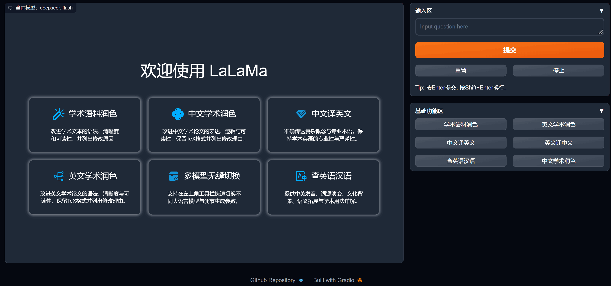

# LaLaMa (Large Language Model for Academic)

<div align="center">
  
</div>

> **这是我们制作的项目 `lalama`（Large Language Model for Academic），是对 [gpt-academic](https://github.com/binary-husky/gpt_academic) 的深度精简处理与全面更新。**
>
> **轻量化、高性能、低延迟的大语言模型学术优化交互平台**
>
> Github 源代码开源和更新：[LaLaMa, Large Language Model for Academic](https://github.com/boyogala/lalama)

---

## 一、项目简介

**LaLaMa**（**La**rge **La**nguage **M**odel for **A**cademic）是对开源项目 [gpt-academic](https://github.com/binary-husky/gpt_academic) 进行深度精简处理、重构与模型全面更新而来的学术研究与论文写作辅助交互系统。

相较于原版包含大量复杂文件批处理与外围插件的沉重架构，**LaLaMa** 遵循 **“极简、纯粹、极速响应”** 的设计哲学：
- **体积与文件数量缩减 >90%**：彻底剥离冗余的“函数插件区”、“更多函数插件”及繁琐的“文件上传/下载区”，项目总文件数精简至不足 90 个，代码与静态资源体积不足 1 MB。
- **秒级启动与零延迟交互**：移除启动阶段阻塞主线程的同步网络探测、自动更新轮询与重型向量数据库预热；通过内存缓存基础功能配置与直连前端提交事件，实现毫秒级按钮响应。
- **专注核心学术场景**：完整保留流式多轮对话与精心调优的 **“基础功能区”** 六大学术功能（中英双语自适应提示词），全面适配各大厂商最新一代旗舰大语言模型。

---

## 二、核心功能一览

### 1. 基础功能区（一键式学术增强）

在右侧 **“输入区”** 输入文本后，点击下方 **“基础功能区”** 的任意按钮，系统将自动根据输入语料匹配专业级中/英文学术提示词（Prompt）并流式输出结果：

| 功能按钮 | 核心作用与输出规范 | 适用场景 |
| :--- | :--- | :--- |
| **学术语料润色** | 改进文本的拼写、语法、清晰度、简洁性与整体学术可读性；先输出完整润色版本，再以 Markdown 表格列出每处修改内容与修改理由。 | 英文/中文论文段落快速润色 |
| **英文学术润色** | 以专业英语学术论文改进专家身份润色文本，分解长句、减少重复；**严格保留输入与输出中的 TeX 源码格式**以便直接复制回 LaTeX 论文，并附 Markdown 修改对比表。 | LaTeX 英文论文、期刊投稿改写 |
| **中文译英文** | 将中文学术文本精准翻译为符合学术规范的英文（非中文自动译为中文），准确传达复杂概念与专业术语，保持原意不变并提升学术严谨度。 | 中文论文初稿译英、摘要翻译 |
| **英文译中文** | 将英文单词、句子或长段落翻译为地道中文；**当输入为单个英文单词时**，自动提供音标、中文释义、常见英文短语搭配及双语例句。 | 英文文献阅读、专业词汇速查 |
| **查英语汉语** | 严格按三部分结构化输出：<br>1. **发音与翻译**（英/美音标或汉语拼音、词性、多义项对照）<br>2. **知识检索与详细介绍**（词源历史流变、构词法、中西文化背景内涵、常见搭配与近反义词辨析）<br>3. **用法总结与注意事项**（学术语域适用范围、典型学术例句、易错点与替代性表达） | 深度双语词汇学习、学术用词考据 |
| **中文学术润色** | 以专业中文学术论文改进专家身份优化文本表达、语法与逻辑；**严格保留 TeX 源文件格式**，先给出订正全文，再通过 Markdown 表格逐条说明修改理由。 | 中文期刊论文、学位论文润色 |

---

### 2. 支持的大语言模型矩阵

LaLaMa 已全面更新并内置国内外主流大模型最新接口（可在界面左上角 **“更换模型”** 标签页中随时动态切换）：

| 提供商 | 支持模型名称 (`AVAIL_LLM_MODELS`) | 配置项 (`config.py`) | 备注 |
| :--- | :--- | :--- | :--- |
| **DeepSeek (深度求索)** | `deepseek-flash`<br>`deepseek-v4-pro` | `DEEPSEEK_API_KEY` | 支持 1M 上下文窗口及思维链 (`reasoning_content`) 流式渲染，国内直连无需代理 |
| **xAI (Grok)** | `grok-4.7`<br>`grok-4.3`<br>`grok-imagine-image-2.0`<br>`grok-build-0.1`<br>`grok-4.20-0309-reasoning` | `GROK_API_KEY` | 覆盖通用旗舰、代码构建、多模态与 2M 超长上下文深度推理 |
| **Google (Gemini)** | `gemini-3.5-flash-lite`<br>`gemini-3.8-flash`<br>`gemini-3.1-pro-preview`<br>`gemini-pro-latest`<br>`gemini-flash-latest`<br>`gemini-4-argon` | `GEMINI_API_KEY` | 全面支持 1M 上下文窗口与多模态输入 |
| **OpenAI** | `gpt-6-astra`<br>`gpt-6.1-sol`<br>`gpt-6-luna`<br>`gpt-5.6-sol`<br>`gpt-5.6-terra`<br>`gpt-5.6-luna` | `API_KEY` | 最新一代 GPT-6 与 GPT-5.6 全系列模型（1.05M 上下文窗口） |
| **其他兼容接口** | `claude-*`, `cohere-command-r-plus`, `llama2`<br>`one-api-*`, `vllm-*`, `ollama-*`, `openrouter-*` | 对应 API Key | 支持标准 OpenAI 兼容网关与本地推理引擎 |

---

## 三、快速安装与部署指南

### 方式一：Linux 系统一键安装与服务管理（推荐）

项目根目录内置了专为 Linux 打造的命令行管理脚本 `lalama`，支持一键后台静默创建虚拟环境、安装依赖、注册系统全局命令以及管理服务生命周期。

#### 1. 赋予执行权限并一键静默安装

```bash
chmod +x lalama
./lalama install
```

> 执行 `./lalama install` 后，脚本会自动将 `lalama` 注册到系统命令路径（`/usr/local/bin/lalama` 或 `~/.local/bin/lalama`），并在后台自动创建 `pylalama` 虚拟环境、安装全部依赖并启动服务。此后可在任意位置直接使用 `lalama` 命令：

#### 2. `lalama` 命令行参数列表

```bash
lalama help        # 查看 lalama 所有支持的参数与帮助说明
lalama install     # 在后台静默自动安装环境依赖并启动服务
lalama status      # 查看当前虚拟环境状态、服务运行状态、PID、运行时长及监听地址 (127.0.0.1:端口)
lalama start       # 在后台启动 LaLaMa 服务并打印访问地址
lalama stop        # 停止后台正在运行的 LaLaMa 服务
lalama restart     # 重启 LaLaMa 服务（修改 config.py 后可执行此命令生效）
lalama logs        # 查看最近的服务运行日志或后台安装进度日志
lalama uninstall   # 一键停止服务、卸载清理 pylalama 虚拟环境及全局命令软链接
```

---

### 方式二：Windows / macOS / 手动虚拟环境部署

#### 1. 创建虚拟环境并安装依赖

```bash
# 创建名为 pylalama 的 Python 虚拟环境（推荐 Python 3.10 ~ 3.12）
python -m venv pylalama

# Windows 激活虚拟环境并安装依赖
.\pylalama\Scripts\pip install "setuptools<80"
.\pylalama\Scripts\pip install -r lalama/requirements.txt

# Linux / macOS 激活虚拟环境并安装依赖
./pylalama/bin/pip install "setuptools<80"
./pylalama/bin/pip install -r lalama/requirements.txt
```

#### 2. 配置 `config.py`

打开 `lalama/config.py`，按需配置以下核心参数：

1. **填写 API Key**：
   - `DEEPSEEK_API_KEY = "sk-..."`（DeepSeek API Key）
   - `GROK_API_KEY = "xai-..."`（xAI Grok API Key）
   - `GEMINI_API_KEY = "..."`（Google Gemini API Key）
   - `API_KEY = "sk-..."`（OpenAI API Key）
   - `DASHSCOPE_API_KEY = "..."`（阿里通义千问 API Key）
   - `ZHIPUAI_API_KEY = "..."`（智谱 GLM API Key）
2. **设置代理网络（访问 OpenAI / Grok / Gemini 等海外接口时需开启）**：
   ```python
   USE_PROXY = True
   if USE_PROXY:
       proxies = {
           "http":  "http://127.0.0.1:10808",   # 修改为您本机代理软件的协议、地址和端口
           "https": "http://127.0.0.1:10808",
       }
   ```
   *(注：DeepSeek 等国内接口已配置直连模式，开启代理后海外模型走代理、DeepSeek 保持直连，互不干扰。)*
3. **设置默认模型与端口**：
   - `LLM_MODEL = "deepseek-flash"`（默认启动时选中的模型）
   - `WEB_PORT = -1`（`-1` 表示自动寻找空闲端口，也可指定固定端口如 `7860`）

#### 3. 启动服务

```bash
cd lalama
python main.py
```

启动成功后，终端会输出形如 `http://127.0.0.1:端口` 的访问链接，并自动在默认浏览器中打开交互界面。

---

## 四、界面操作说明

1. **常规对话与快捷键**：
   - 在右侧 **“输入区”** 输入问题，按 <kbd>Enter</kbd> 或点击 **“提交”** 按钮即可发送；按 <kbd>Shift</kbd> + <kbd>Enter</kbd> 换行。
   - 生成过程中可随时点击 **“停止”** 按钮中断输出；点击 **“重置”** 可清空当前会话上下文（旧会话会自动保存在左侧浮动时间线历史中）。
2. **左上角悬浮工具栏**：
   - **更换模型**：动态切换当前使用的大语言模型，实时调节 `Top-p`、`Temperature`、`Local LLM MaxLength` 以及 `System prompt`（自动持久化保存在浏览器 Cookie 中）。
   - **界面外观**：支持动态切换 UI 主题（`Default`、`Chuanhu-Small-and-Beautiful`、`High-Contrast` 等）、更换聊天框字体类型、调节字号大小、显示/隐藏基础功能区、一键切换明暗模式以及打开新对话窗口。
   - **帮助**：快速访问项目 GitHub 源码仓库获取更新。

---

## 五、项目结构说明

```text
lalama/
├── main.py                  # 主程序入口：构建精简版 Gradio 界面并挂载 FastAPI 服务
├── config.py                # 全局配置文件：API Key、代理设置、模型列表与界面参数
├── core_functional.py       # 基础功能区定义：6 大核心学术功能的双语 Prompt 与内存缓存调度
├── toolbox.py               # 核心工具库：参数接驳装饰器 ArgsGeneralWrapper、UI 刷新、上下文管理
├── check_proxy.py           # 代理检测与分词器后台预热模块
├── lalama                   # Linux 一键安装、启动、状态查看与卸载脚本
├── requirements.txt         # 精简后的 Python 依赖清单
├── Dockerfile               # 容器化构建配置
├── docker-compose.yml       # Docker Compose 编排配置
├── docs/
│   └── logo.png             # 网页 Favicon 图标资源
├── request_llms/            # 大语言模型路由与协议适配层
│   ├── bridge_all.py        # 统一模型路由表 (model_info) 与分发入口
│   ├── oai_std_model_template.py # 标准 OpenAI 协议流式模板（含思维链 reasoning_content 支持）
│   ├── bridge_chatgpt.py    # OpenAI / Azure / API2D 协议适配
│   ├── bridge_google_gemini.py & com_google.py # Google Gemini 协议适配
│   ├── bridge_qwen.py & com_qwenapi.py         # 通义千问协议适配
│   ├── bridge_zhipu.py & com_zhipuglm.py       # 智谱 GLM 协议适配
│   └── ...                  # 其他模型桥接模块
├── shared_utils/            # 底层共享工具层
│   ├── fastapi_server.py    # FastAPI + Uvicorn 高并发服务与安全路由挂载
│   ├── advanced_markdown_format.py # Markdown / LaTeX 公式 / 代码高亮渲染管线
│   ├── cookie_manager.py    # 前后端状态与自定义按钮持久化缓存
│   ├── context_clip_policy.py # 长上下文自动裁剪策略
│   └── text_mask.py         # 中英双语自适应提示词掩码解析器
└── themes/                  # 前端主题、CSS 样式与自定义事件 JS 脚本
    ├── gui_toolbar.py       # 左上角悬浮工具栏（更换模型 / 界面外观 / 帮助）
    ├── gui_floating_menu.py # 隐藏状态支撑组件
    ├── common.js & init.js  # 前端高度自适应、复制按钮、历史时间线与 Cookie 同步脚本
    └── ...                  # 主题样式表与 SVG 图标
```

---

## 六、开源协议

本项目遵循 **GPL-3.0** 开源协议。欢迎提交 Issue 或 Pull Request 共同完善 [LaLaMa](https://github.com/boyogala/lalama)！
